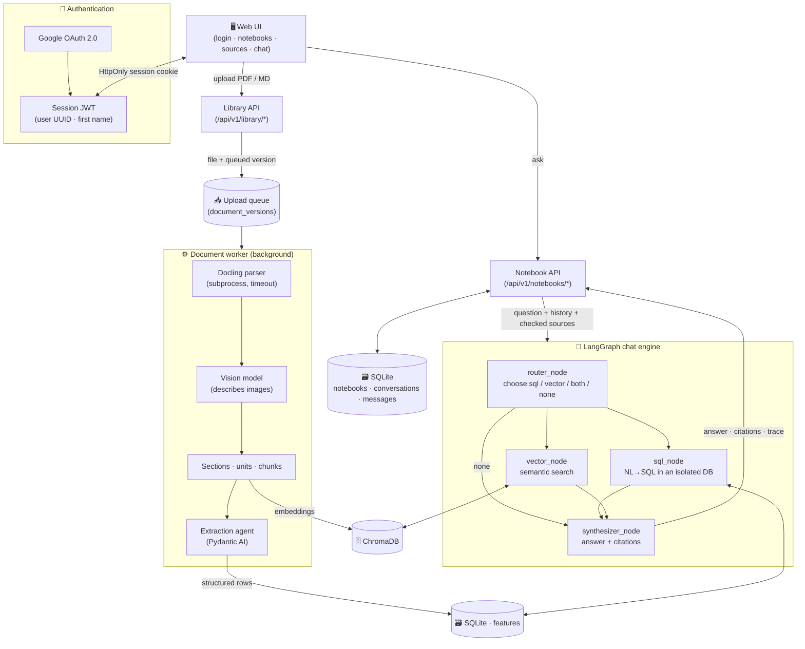

# ArgosAI — Competitive Intelligence System

*Technical Documentation & User Guide*

---

## 1. Overview

ArgosAI is an AI-powered competitive intelligence tool. Users upload competitor documents
(PDF or Markdown) — price lists, brochures, reports — and then ask questions about them in
natural language. Every answer is built only from the documents the user selects, and every
fact carries a numbered citation back to the document, version and page it came from.

The system is designed for **product**, **strategy** and **business intelligence** teams that
want competitive insights quickly, without reading long documents by hand.

It runs as a single-tenant web app: one deployment per organisation, one admin, sign-in with
Google.

---

## 2. Features

- **Library** — documents shared by the whole team. Each document keeps a version history;
  uploading an identical file reuses the existing version, and uploading a file that looks
  like a new version of an existing document suggests linking it as one.
- **Notebooks** — private workspaces. A notebook holds up to 10 sources from the Library,
  each pinned to a version and switched on or off with a checkbox. Each notebook has its own
  conversations.
- **Chat with citations** — answers come only from the checked sources, with `[n]` citation
  chips that show the document, version, upload date and page.
- **Hybrid retrieval** — a router sends each question to structured data (NL→SQL over the
  extracted `features` table), to semantic search (ChromaDB), or to both.
- **Background processing** — uploads are parsed, described (images via a vision model),
  indexed and extracted by a queue worker; the UI shows the progress of each document.
- **Transparent failures** — a failed message can be resent; an answer built while one data
  source was unavailable is marked as incomplete. The route, SQL, document chunks, timings and
  token usage behind each answer are stored with the message (and sent to Langfuse when enabled).
- **Voice** — speech-to-text input (language detected automatically) and spoken answers.
- **Admin** — the admin can deactivate users; their documents are transferred to the admin.

---

## 3. System Architecture



### Document processing

Uploading only stores the file and queues a version; a background worker processes it
through these stages, which the UI shows as progress:

`queued → parsing → vision → indexing → extracting → ready` (or `failed` / `cancelled`)

- **Parsing** — Docling reads text, layout and tables in a separate subprocess that is killed
  and restarted if it hangs. Its time limit grows with the page surface (a newspaper-sized page
  counts as several A4 pages).
- **Vision** — images and charts are described by an OpenAI vision model; one unreadable image
  does not fail the document.
- **Profile** — an LLM reads the outline and the start of the document and records what it is:
  type (price list, spec sheet, product terms, financial statement, …), issuer, main products or
  companies, period, and whether it states customer prices. The profile is the document-level
  context for extraction, and the router and synthesizer see the profiles of the checked sources.
  A failed profile does not stop processing.
- **Indexing** — the content is split into chunks and embedded into ChromaDB.
- **Extracting** — an LLM agent writes structured rows (`brand_name`, `product_name`,
  `model_code`, `price`, `price_currency`, `advantages`, `disadvantages`) linked to their source
  section. `product_name` is the product line plus model and variant, without the brand;
  `model_code` keeps the model number, part number or SKU as written. Every unit carries the
  document profile: in a document about one product, its options and components (processors,
  operating systems, card networks…) stay attributes of that product, while in a price list or
  catalogue every item with its own price or code — accessories, spares, kits, service plans —
  is a product. A recurring annual or subscription fee is the product's price.
- **Publish** — sections, features and the `ready` status are written in one SQL
  transaction, so chat never sees a half-processed version.

Temporary errors are retried after 1, 5 and 15 minutes (3 attempts). Vision and extraction
results are cached, and a new version of a document reuses the vectors of unchanged chunks,
so reprocessing does not pay twice for the same work.

### Answering a question

1. Only sources that are **checked** and **ready** are used.
2. The **router** picks `sql`, `vector`, `both` or `none`. If routing fails, both are used.
3. **NL→SQL** runs in an in-memory database that only contains the `features` rows of the
   active sources. Other tables do not exist there, the SQL must be a single `SELECT`, an
   authorizer blocks everything else, and there are time and row limits.
4. **Vector search** only returns chunks of the active versions.
5. The **synthesizer** writes the answer in the user's language, citing labels that come from
   the retrieved data. The API returns only the citations actually used.
6. The first answer of a new conversation triggers an auto-generated title.

---

## 4. Security

- **Sign-in** — Google OAuth only. Access is limited to one Google Workspace domain (checked
  through Google's verified `hd` claim, not the email suffix), or to personal Gmail accounts
  when the domain is set to `gmail.com`. The email must be verified by Google.
- **Session** — an `HttpOnly`, `SameSite=Lax` cookie (`Secure` over https) holding a JWT with
  only the user's UUID and first name; it expires after 60 minutes. The token never appears in
  a URL or in JavaScript, and `Authorization: Bearer` headers are not accepted.
- **Every API call requires a signed-in, active user.** The app page and its scripts are only
  served to signed-in users; `/login`, `/css`, `/health/live` and the API docs are public.
- **No direct browser access to the API** — Fetch Metadata headers are checked: opening an
  API URL in the address bar, a link or an iframe, or calling it from another site, returns an
  empty 404. Cookie-authenticated writes without Fetch Metadata must carry an allowed `Origin`.
- **Rate limits per user** (per minute): chat 20, voice 10, upload 10, everything else 120;
  sign-in attempts 10 per IP.
- **Uploads** — streamed with size limits, stored under UUID names (no path traversal), and
  checked for type and page count.
- **Errors** — clients get a stable error code, a safe message and a request ID; technical
  details only go to the log.
- **AI answers are untrusted** — the answering model reads uploaded documents, so:
  - prompts are split into blocks (`<<HISTORY>>`, `<<DATA>>`, `<<INSTRUCTIONS>>`, `<<QUESTION>>`,
    `<<CURRENT_DATE>>`), and the rules tell the model to ignore instructions found inside
    history or document data (indirect prompt injection);
  - the answer's Markdown is rendered through DOMPurify (no scripts, event handlers, iframes,
    forms, images or inline styles), or as plain text if the libraries did not load;
  - the pages send a Content-Security-Policy (scripts only from this site and the two pinned,
    integrity-checked CDN libraries; no inline scripts; network calls only to this site).

---

## 5. Installation

Pick the path that fits your machine:

| Your situation | Recommended path |
|---|---|
| Just want it running, any OS | **A. Docker** |
| Developing the code (Windows / Linux / Apple Silicon Mac) | **B. Without Docker** |

Both paths install the same locked dependencies (`pyproject.toml` + `uv.lock`) and pick the
PyTorch variant the same way.

### Step 1 — Get the code and create `.env`

```bash
git clone <repo-url> argos
cd argos
cp .env.example .env        # Windows (cmd/PowerShell): copy .env.example .env
```

`.env` holds **only secrets and the access policy**. Fill in every value — the app refuses to
start if one is empty:

| Variable | What to put there |
|---|---|
| `OPENAI_API_KEY` | Your key from https://platform.openai.com/api-keys |
| `GOOGLE_CLIENT_ID`, `GOOGLE_CLIENT_SECRET` | An OAuth client from the Google Cloud console — step by step in the next section |
| `SECRET_KEY` | A long random string: `python -c "import secrets; print(secrets.token_urlsafe(64))"` |
| `ALLOWED_GOOGLE_DOMAIN` | Your Google Workspace domain (e.g. `company.com`), or `gmail.com` to allow personal Gmail accounts |
| `ADMIN_EMAIL` | The email of the single admin account |
| `ALLOWED_ORIGINS` | The URL users open, e.g. `http://localhost:8000` (comma-separated if more than one) |

> ⚠️ Never commit `.env` or paste its values into issues, docs or screenshots. It is listed in
> `.gitignore` and `.dockerignore`.

### Google sign-in credentials (`GOOGLE_CLIENT_ID`, `GOOGLE_CLIENT_SECRET`)

Argos signs users in with Google (scopes `openid email profile` only). You create the OAuth
client once in the Google Cloud console; the screens below are the current **Google Auth
Platform** ([Google's guide](https://support.google.com/cloud/answer/15544987),
[managing clients](https://support.google.com/cloud/answer/15549257)).

1. **Project.** Open https://console.cloud.google.com, and in the project picker at the top
   choose an existing project or **New project**.
2. **Register the app with Google Auth.** Menu ☰ → **APIs & Services** → **OAuth consent
   screen** (this opens the Google Auth Platform; direct link:
   https://console.cloud.google.com/auth/overview) → **Get started**, then fill in:
   - **App information** — *App name* (e.g. `ArgosAI`) and *User support email* (your own
     address or a Google Group you manage).
   - **Audience** — **Internal** if everyone signs in with accounts of your Google Workspace
     organisation (matches `ALLOWED_GOOGLE_DOMAIN=company.com`; only available when the project
     belongs to that organisation). **External** for any Google account (needed for
     `ALLOWED_GOOGLE_DOMAIN=gmail.com`).
   - **Contact information** — an email address Google can write to about the project.
   - **Finish** — agree to the Google API Services User Data Policy, then **Create**.
3. **External apps: testing or production.** An External app starts in **Testing**. Open
   **Audience**: either add the people who may sign in under **Test users** (at most 100), or
   click **Publish app** to make it available to every Google account (Argos still lets in only
   the domain in `ALLOWED_GOOGLE_DOMAIN`). The `openid email profile` scopes are not sensitive,
   so publishing needs no security review; Google asks for brand verification only if you want
   your app name and logo shown on the consent screen.
4. **Create the client.** **Clients** → **Create client** → *Application type*: **Web
   application** → a *Name* (e.g. `argos-web`), then add:
   - **Authorized JavaScript origins**: `http://localhost:8000`
   - **Authorized redirect URIs**: `http://localhost:8000/api/v1/auth/google/callback`

   For a deployment, add your real address instead, e.g. `https://argos.company.com` and
   `https://argos.company.com/api/v1/auth/google/callback`. Rules: `https://` is required
   except for `localhost`; no raw IP addresses; an origin has no path; a port other than 80/443
   must be written out. Changes can take from 5 minutes to a few hours to apply.
5. **Copy the ID and the secret right away.** After **Create**, the dialog shows the
   **Client ID** (`…apps.googleusercontent.com`) and the **Client secret**. Put them in `.env`
   as `GOOGLE_CLIENT_ID` and `GOOGLE_CLIENT_SECRET`. **The secret is shown only this once**
   (later the console shows only its last four characters), so copy it or download the JSON
   now. Lost it? Open the client → **Add secret**, put the new one in `.env`, then disable and
   delete the old secret.

Common sign-in errors: `redirect_uri_mismatch` (the callback URL is not listed exactly — check
scheme, host, port), `org_internal` (Internal audience, but the account is outside your
organisation), `access_denied` (External app in Testing and the account is not a test user).

### Choose the PyTorch variant: `cpu` or `gpu`

PyTorch is used only by Docling, to read PDFs. You pick one variant, in Docker and without
Docker alike; nothing is detected automatically:

| Variant | Use it when |
|---|---|
| `cpu` | Any machine: no NVIDIA GPU, an AMD/Intel GPU, a Mac, a server without GPU. The safe default. |
| `gpu` | An NVIDIA GPU with a recent driver. First pick the CUDA build that fits it (next section). |

The GPU only speeds up document parsing. Chat, extraction and embeddings run through the OpenAI
API either way, so `cpu` is a fine choice for most deployments.

### GPU: pick the CUDA build for your machine

The `gpu` variant installs one CUDA build of PyTorch 2.8. Which one works depends on your GPU and
its driver, so check your own machine:

1. **Look at your GPU and driver.** Run `nvidia-smi` (Windows: in PowerShell or cmd; it comes
   with the NVIDIA driver). The header shows the GPU name, `Driver Version` and `CUDA Version`
   (the newest CUDA your driver supports). If `nvidia-smi` is not found, there is no NVIDIA
   driver: install it from https://www.nvidia.com/drivers, or use `cpu`.
2. **Pick the build** — the newest one your GPU and driver allow:

   | Build | Minimum driver, Windows / Linux | GPUs |
   |---|---|---|
   | `cu129` *(default)* | ≥ 576.02 / ≥ 575.51.03 | Volta and newer: GTX 16xx, RTX 20xx, 30xx, 40xx, 50xx, data-centre GPUs from V100 on |
   | `cu128` | ≥ 570.65 / ≥ 570.26 | same as `cu129` |
   | `cu126` | ≥ 560.76 / ≥ 560.28.03 | also Maxwell and Pascal: GTX 9xx, GTX 10xx — **the only build for these**; not RTX 50xx |

   In short: GTX 9xx/10xx → `cu126`. Everything newer → `cu129` if `nvidia-smi` shows CUDA
   Version 12.9 or higher, else `cu128` (12.8), else `cu126` (12.6), else update the driver.
   (PyTorch 2.8 dropped Maxwell and Pascal from its CUDA 12.8/12.9 builds — [release
   notes](https://github.com/pytorch/pytorch/releases/tag/v2.8.0); driver minimums from
   [NVIDIA](https://docs.nvidia.com/cuda/cuda-toolkit-release-notes/index.html).)
3. **Set it in `pyproject.toml`** — only if you need another build than `cu129`. Change the last
   part of one URL:

   ```toml
   [[tool.uv.index]]
   name = "pytorch-gpu"
   url = "https://download.pytorch.org/whl/cu129"   # → cu128 or cu126
   explicit = true
   ```

   then re-resolve the lock file (requires [uv](https://docs.astral.sh/uv/)):

   ```bash
   uv lock
   ```

   Nothing else changes: the extra stays `gpu`, the Docker profile stays `gpu`. Commit the
   changed `pyproject.toml` and `uv.lock` together if the machine you deploy to needs them.
4. **Install and check** — with Docker (A) or without (B) below, then:

   ```bash
   uv run python -c "import torch; print(torch.__version__, torch.cuda.is_available(), torch.cuda.get_device_name(0))"
   # Docker:
   docker compose --profile gpu exec argos-gpu python -c "import torch; print(torch.__version__, torch.cuda.is_available(), torch.cuda.get_device_name(0))"
   ```

   You want `2.8.0+cu129 True <your GPU>`. `False` means the driver is too old for the build:
   update it, or choose an older build. The app still runs (on CPU) in that case.

### A. Docker

Requires **Docker Desktop** (Windows/macOS) or Docker Engine (Linux). One compose file, one
profile per variant:

```bash
docker compose --profile cpu up -d --build     # image argos:cpu
docker compose --profile gpu up -d --build     # image argos:gpu (NVIDIA)
```

Use the same `--profile` for every other command (`logs`, `down`, …). For `gpu`, the host needs
the NVIDIA driver, plus the [NVIDIA Container
Toolkit](https://docs.nvidia.com/datacenter/cloud-native/container-toolkit/) on Linux, or Docker
Desktop with the WSL2 backend on Windows. No CUDA install is needed in the image: the PyTorch
wheels bring their own CUDA libraries. The `gpu` image is large: plan for roughly 15 GB of free
space on the drive that holds Docker's data (on Windows usually `C:`); if the disk fills
mid-build, Docker Desktop crashes with `failed to receive status: ... EOF`.

The container runs as an unprivileged user (UID 1000) and keeps all data in `./data`, which is
mounted from the host. On a Linux host where your user is not UID 1000, make the folder
writable once: `mkdir -p data && sudo chown -R 1000:1000 data`. Docker Desktop (Windows/macOS)
needs nothing.

### B. Without Docker

Requires [uv](https://docs.astral.sh/uv/getting-started/installation/) (it installs a matching
Python 3.11+ itself if needed). From the project folder:

```bash
uv sync --extra cpu          # or: uv sync --extra gpu
uv run uvicorn app.main:app --reload
```

`uv sync` creates `.venv/` with exactly the versions in `uv.lock`. Intel Macs have no PyTorch 2.8
build: use Docker there.

> The app must run as **one process** (no `--workers N`): the document worker runs inside
> the app, and ChromaDB's local client is not safe across processes.

### Step 2 — Open the app

| URL | What it is |
|---|---|
| `http://localhost:8000` | The app (redirects to `/login` when you are not signed in) |
| `http://localhost:8000/docs` | API documentation ("Try it out" works when you are signed in in the same browser) |
| `http://localhost:8000/health/live` | Liveness check (public, used by Docker) |
| `http://localhost:8000/health/ready` | Readiness of each component (admin only) |

The account whose email matches `ADMIN_EMAIL` is the admin.

---

## 6. Configuration

| Where | What | Examples |
|---|---|---|
| `.env` | Secrets and access policy only | API keys, OAuth client, `SECRET_KEY`, allowed domain, admin email, CORS origins |
| `app/core/config.py` (`AppConfig`) | Every other setting, as constants in code | Models, timeouts, upload limits, rate limits, notebook size, OCR, worker settings, API docs on/off |
| OS environment (set by `docker-compose.yml`) | Per-machine infrastructure | `DATA_DIR`, `DOCLING_DEVICE`, `HF_HOME` |

**Data** — everything lives in `DATA_DIR` (default `./data`): `argos.db` (SQLite), `chroma/`
(vectors), `queue/` (uploaded files waiting for the worker) and, in Docker, the model cache.
With Docker, `./data` is mounted into the container, so data survives rebuilds.

**Docling device** — `DOCLING_DEVICE` is `auto` (GPU if CUDA/MPS is available, else CPU),
`cuda`, `cpu` or `mps`. The startup log prints the device in use.

**OCR** — off by default (`DOCLING_OCR = False` in `config.py`): text, layout and tables are
extracted directly and images are described by the vision model, so OCR is only needed for
scanned PDFs. Turning it on makes processing slower, especially on CPU.

**Upload limits** (defaults) — PDF or Markdown, 10 MB per file, 100 pages, 5 files and 30 MB
per upload.

**Logs** — in a terminal, aligned and coloured lines (time, level, component, message);
in Docker or when redirected to a file, JSON lines. Both carry the request ID and context
(user, notebook, version, stage). Force one with `LOG_FORMAT = "json"` or `"text"` in
`config.py`; set `NO_COLOR=1` to turn colours off. Every OpenAI call is recorded in the `llm_calls` table (model, tokens, latency,
status — never prompts or document content) and kept for 90 days.

### Observability (OpenTelemetry → Langfuse)

Argos emits traces with **OpenTelemetry** and sends them over OTLP/HTTP; Langfuse is only the
destination, so another OTLP backend works the same way. Tracing is **off** until keys are set.

**Turn it on**

1. Create a project in [Langfuse](https://langfuse.com) (Cloud or self-hosted) and copy its keys
   into `.env`:
   ```
   LANGFUSE_PUBLIC_KEY=pk-lf-…
   LANGFUSE_SECRET_KEY=sk-lf-…
   ```
2. Check the endpoint in `app/core/observability/telemetry/config.py` (its own settings, separate from the app
   config):

   | Langfuse | `OTLP_ENDPOINT` |
   |---|---|
   | Cloud EU (default) | `https://cloud.langfuse.com/api/public/otel` |
   | Cloud US | `https://us.cloud.langfuse.com/api/public/otel` |
   | Self-hosted (≥ 3.22) | `http://localhost:3000/api/public/otel` |

3. Restart Argos. The startup log says `Telemetry enabled (otlp → …)`, and `/health/ready` shows
   the same under `telemetry`. To look at spans locally without Langfuse, set
   `EXPORTER = "console"` (spans are printed to stdout); `EXPORTER = "none"` turns tracing off.

**What you see in Langfuse**

- **`chat.message`** — one trace per chat message (and per resend); session = the conversation,
  user = the signed-in user. Children: `routing` (output `{route, reasoning}`, with the `router`
  LLM call), `sql` (`nl2sql` call + `sql.execute` with the SQL and rows), `vector_search` (the
  retrieved chunks), `synthesis` (`synthesizer` call), and `title` for a new conversation.
  The router's decision is also a trace tag — `route:sql`, `route:vector`, `route:both`,
  `route:none`, `route:fallback` — so you can filter chats by route. `degraded` / `retry` tags
  and ERROR spans with the error code show what went wrong.
- **`document.process`** — one trace per processing attempt of a document version; user = the
  uploader. Children: `parsing`, `vision`, `profile`, `indexing`, `extracting`, `publish`, with every
  Vision, embedding and extraction call under them. The outcome is `ready`, `retry_scheduled`
  (with the retry delay), `failed` or `cancelled`.
- Every AI call is a *generation* with model, token usage and — when its price is set — cost.
- Log lines carry `trace_id`, and so does the trace stored with each answer.

**Content and privacy** — with `CAPTURE_CONTENT = True` (the default) traces include prompts,
answers, SQL, retrieved document chunks, extracted rows and image descriptions, cut to
`MAX_CONTENT_CHARS` per field. With Langfuse Cloud this content is stored on Langfuse's servers.
Images, audio, files, cookies, tokens and API keys are never sent. Set `CAPTURE_CONTENT = False`
to keep only metadata (timings, models, tokens, routes, errors).

**Cost** — Langfuse does not price OpenTelemetry data on its own, so Argos sends the cost
itself. Fill in `MODEL_PRICES_USD_PER_1M_TOKENS` (and, if you want, `STT_PRICE_USD_PER_MINUTE`
and `TTS_PRICE_USD_PER_1M_CHARS`) in `app/core/observability/telemetry/config.py` with the prices you pay;
models without a price report token usage only.

### Docker commands

Add the profile you started with (`--profile cpu` or `--profile gpu`) to every command:

| Command | Description |
|---|---|
| `docker compose --profile cpu up -d --build` | Build and run in the background |
| `docker compose --profile cpu logs -f` | Follow logs |
| `docker compose --profile cpu down` | Stop and remove containers (data in `./data` is kept) |

### Troubleshooting

| Problem | Fix |
|---|---|
| The app does not start: "Required settings missing in .env" | Fill in every value listed in Step 1 |
| Google says `redirect_uri_mismatch` | Add `http://<host>/api/v1/auth/google/callback` to the OAuth client's redirect URIs |
| Sign-in fails with "This Google account is not allowed to sign in" | The account does not match `ALLOWED_GOOGLE_DOMAIN` (a Workspace domain, or `gmail.com`) |
| `torch.cuda.is_available()` is `False` with `gpu` | The driver is older than the CUDA build: update it, or pick an older build (see *GPU: pick the CUDA build*); the app still runs on CPU |
| First PDF upload is slow | Docling loads/downloads its models on first use; later runs use the cache |
| Docker: `PermissionError` / `attempt to write a readonly database` under `/app/data` | The host's `./data` is not writable by UID 1000: `sudo chown -R 1000:1000 data` |
| `--profile gpu` fails with "could not select device driver" | The NVIDIA Container Toolkit / WSL2 GPU support is not installed — use `--profile cpu` |
| `uv sync` refuses `--extra cpu --extra gpu` | The variants exclude each other: pick one |

---

## 7. API Overview

The API is used by the web app; every endpoint except sign-in and `/health/live` needs a
signed-in user. Full details are in `/docs`.

| Area | Endpoints |
|---|---|
| Auth | `GET /api/v1/auth/google/login`, `GET /api/v1/auth/google/callback`, `POST /api/v1/auth/logout`, `GET /api/v1/users/me` |
| Library | `/api/v1/library/documents` (upload, search, details, rename, delete), `.../versions` (new version, delete version), `/api/v1/library/versions/{id}` (processing status), `/api/v1/library/pending/{id}/resolve` (similar upload) |
| Notebooks | `/api/v1/notebooks` (list, create, rename, delete), `.../sources` (add from Library, upload, check/uncheck, update version, remove) |
| Chat | `POST /api/v1/notebooks/{id}/messages`, `.../conversations` (list, read, rename, delete), `.../messages/{id}/retry` |
| Voice | `POST /api/v1/voice/stt`, `POST /api/v1/voice/tts` |
| Admin | `GET /api/v1/admin/users`, `PATCH /api/v1/admin/users/{id}` |
| Health | `GET /health/live`, `GET /health/ready` (admin) |

Errors always have the same shape:

```json
{"error": {"code": "RATE_LIMITED", "message": "Too many requests. Try again in 60 seconds.", "request_id": "…", "retryable": true}}
```

---

## 8. Development

```bash
ruff check app
```

### Code structure

```
bootstrap ─► api ─► engines (orchestrators) ─► services (features) ─► tools (Base… contracts)
                                                                       core (shared kernel)
```

| Folder | What lives there |
|---|---|
| `app/bootstrap.py` | The composition root: builds every tool, repository, service and engine once at startup and wires them through constructors |
| `app/api/` | Routers, FastAPI dependencies (`dependencies.py`) and HTTP schemas (`schemas/`). Routers only translate HTTP; they get everything through `Depends` |
| `app/engines/` | Orchestrators that use several services: the chat flow (`ChatOrchestrator`, the LangGraph `ChatEngine`) and the document pipeline + worker |
| `app/services/<feature>/` | One feature each (library, notebook, conversation, nl2sql, ingestion, extraction, user, voice): entities (`model.py`), repository contracts (`ports.py`) and use cases (`service.py`) |
| `app/tools/<tool>/` | External tools behind a contract: `base.py` (abstract class + its types) and the implementations — `llm`, `embedding`, `vector_store`, `document_parser`, `vision`, `extraction`, `speech`, and `storage/sqlite` (implements the services' ports) |
| `app/tools/factory.py` | The only place that picks a concrete tool, from the `*_PROVIDER` constants in `config.py` |
| `app/core/` | Shared kernel: config, errors, database, security, session, middleware, and `observability/` — `logs/` (log setup, context, request ID), `ai_calls/` (the `llm_calls` recorder, always on) and `telemetry/` (OpenTelemetry → Langfuse, optional, its own config) |

Rules:

- Dependencies point inward: services never import engines or api; engines never import api.
- Services, engines and routers use tools only through `app/tools/<tool>/base.py`; only
  `bootstrap.py` and `tools/factory.py` know the implementations.
- `core/` imports nothing from the other layers.
- Services, engines and tools do not import FastAPI.

**Switching a tool** (e.g. another vector database): add an implementation next to its
`base.py`, add a branch in `tools/factory.py`, change the provider constant in `config.py`.

### Dependencies

- `pyproject.toml` — the **direct** dependencies (edit these), the PyTorch variants as the
  mutually exclusive extras `cpu` and `gpu` (each mapped to its PyTorch index), the dev group
  (ruff) and the ruff config.
- `uv.lock` — every resolved version, for every OS and both variants. Commit it; Docker installs
  it with `uv sync --frozen`, so a build never re-resolves.

Docling is installed as `docling-slim` with the extras the app uses (PDF, Markdown, layout and
table models, OCR, chunking), not every document format.

To add or upgrade a package, edit `pyproject.toml`, then:

```bash
uv lock                      # re-resolve; keeps the other locked versions
uv sync --extra cpu          # apply it to your .venv
```

To use another CUDA build for `gpu`, change the `pytorch-gpu` index URL and run `uv lock`
(§5, *GPU: pick the CUDA build*).

Linting: `uv run ruff check app eval`.

### Database migrations

The schema is versioned in `app/core/migrations.py` and applied automatically on startup.
Add a new migration at the end of the list; never edit one that has already shipped.

---

## 9. Reliability Test

The same question was asked **3 times in a row** to check how consistent the generated SQL and
the answers are, once in **Indonesian** and once in **English**.

> This test was run on an earlier version of Argos, before notebooks and citations, when the
> `features` table used `competitor_name` and `feature_name` (now `brand_name` and
> `product_name`). The answers are kept as they were produced.

### Table A — Indonesian prompt (3 attempts)

*Prompt: "Coba cari tahu tentang Scopely, apa kelebihan atau kekurangan mereka?"*
(*"Find out about Scopely — what are their strengths or weaknesses?"*)

| Attempt | Generated SQL | AI Answer (Summary) |
|---|---|---|
| #1 | `SELECT competitor_name, feature_name, advantages, disadvantages FROM features WHERE competitor_name LIKE '%Scopely%' OR feature_name LIKE '%Scopely%' ORDER BY competitor_name, feature_name;` | Scopely unggul sebagai data source Star Trek™ Fleet Command dan MONOPOLY GO! raih $1.2B di 2023. Tidak ada kekurangan tercantum. |
| #2 | `SELECT competitor_name, feature_name, advantages, disadvantages FROM features WHERE competitor_name LIKE '%Scopely%' OR feature_name LIKE '%Scopely%' ORDER BY competitor_name, feature_name` | MONOPOLY GO! menduduki puncak growth chart revenue 2023 ($1.2B). Scopely juga menjadi basis data case study. Kekurangan: tidak terlihat. |
| #3 | `SELECT competitor_name, feature_name, advantages, disadvantages FROM features WHERE competitor_name LIKE '%Scopely%' OR feature_name LIKE '%Scopely%' ORDER BY competitor_name, feature_name` | Dua kelebihan utama: revenue leadership (MONOPOLY GO! $1.2B) dan data source attribution. Kekurangan tidak tercantum di data. |

### Table B — English prompt (3 attempts)

*Prompt: "Find out about Scopely, what are their strengths and weaknesses?"*

| Attempt | Generated SQL | AI Answer (Summary) |
|---|---|---|
| #1 | `SELECT competitor_name, feature_name, advantages, disadvantages FROM features WHERE competitor_name LIKE '%Scopely%' OR feature_name LIKE '%Scopely%' ORDER BY competitor_name, feature_name;` | Two strengths: data source for Star Trek™ case study + MONOPOLY GO! revenue $1.2B topped 2023 chart. No weaknesses visible. |
| #2 | `SELECT competitor_name, feature_name, advantages, disadvantages FROM features WHERE competitor_name LIKE '%Scopely%' OR feature_name LIKE '%Scopely%' ORDER BY competitor_name, feature_name;` | Scopely shows two clear strengths. MONOPOLY GO! generated $1.2B in 2023 and topped the revenue growth chart. No weaknesses shown. |
| #3 | `SELECT competitor_name, feature_name, advantages, disadvantages FROM features WHERE competitor_name LIKE '%Scopely%' OR feature_name LIKE '%Scopely%' ORDER BY competitor_name, feature_name` | Strengths: data source attribution + MONOPOLY GO! $1.2B revenue leadership 2023. Weaknesses: none visible in current data. |

### Conclusions

- **Consistent SQL:** all 6 attempts produced the same query.
- **Language follows the user:** the answer came back in the language of the question.
- **Consistent content:** the key facts (MONOPOLY GO! $1.2B, Star Trek™ data source) appeared
  in every answer.
- **Natural variation:** sentence structure varied slightly, as expected from a generative model.

---

## 10. Limitations

### Data & ingestion

- Answer quality depends on the uploaded documents. Ambiguous, incomplete or unstructured data
  leads to less accurate extraction.
- Only **PDF** and **Markdown** are supported. DOCX, XLSX and standalone images are not.
- Scanned PDFs need OCR to be turned on in `config.py`, which is slower.

### AI & accuracy

- The LLM can still write a suboptimal SQL query for very complex or ambiguous questions; the
  safety layers only stop it from reading or changing anything it should not.
- Similar-document suggestions are based on text overlap and are only suggestions; the user
  always decides.

### Infrastructure

- **One process only.** The document worker, rate limits and ChromaDB client live in the app
  process, so it cannot be scaled to several workers or instances as is.
- **SQLite** is fine for a team-sized deployment but not for heavy concurrent writes; larger
  setups should move to PostgreSQL.
- **OpenAI costs are per call.** A chat message triggers 3–5 calls (router, NL→SQL, embedding,
  synthesizer, plus a title on the first turn), and each document triggers vision, embedding
  and extraction calls. All text and vision calls use `gpt-6-luna` (OpenAI's cheapest current
  model) with a reasoning effort per use; speech uses `gpt-transcribe` and `gpt-4o-mini-tts`.
  The models are set in `app/core/config.py`, every call is recorded in `llm_calls`, and with
  telemetry on, Langfuse shows the cost per call.
- **Text-to-speech has no successor yet.** `gpt-4o-mini-tts` (like `tts-1`) shuts down on
  2027-01-06 and OpenAI's replacement is a Realtime API model, not a drop-in for the
  `audio/speech` endpoint Argos uses — "listen to the answer" needs a change before then.

---

*ArgosAI — Built with FastAPI · LangGraph · Pydantic AI · ChromaDB · SQLite · Docling · Google OAuth · OpenAI*
