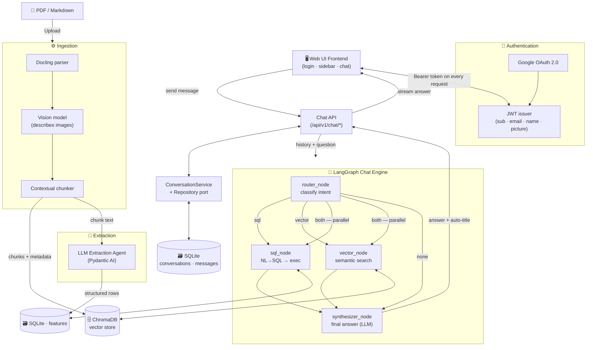
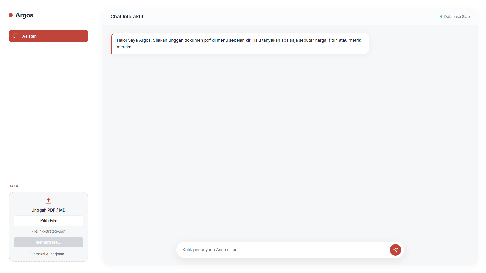
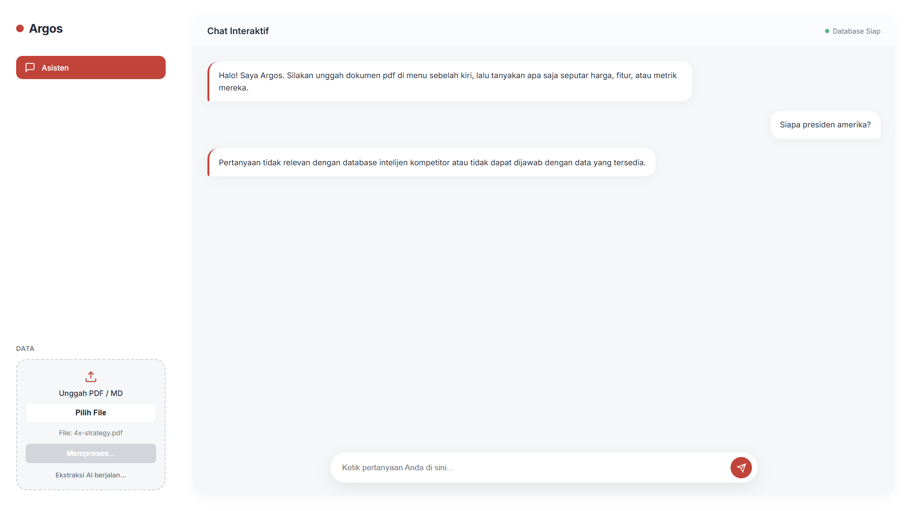
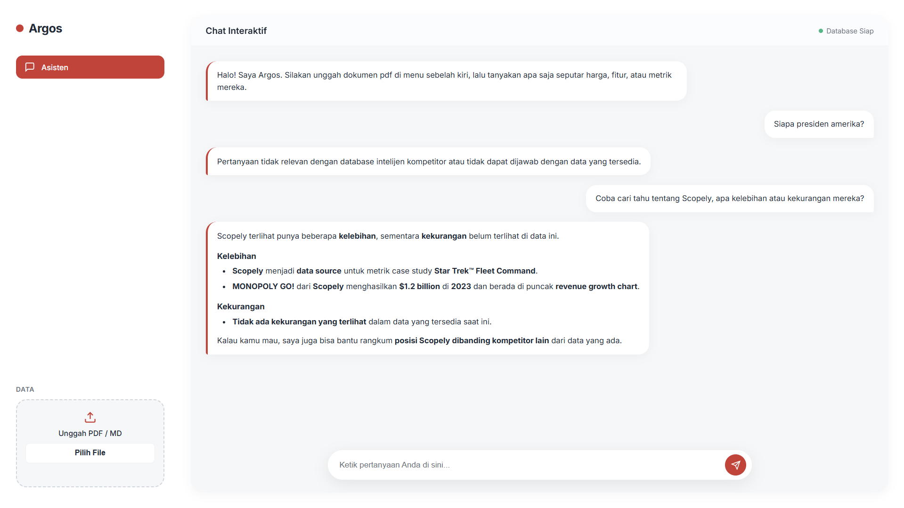

# ArgosAI — Competitive Intelligence System

*Technical Documentation & User Guide*

---

## 1. Overview

ArgosAI is an AI-powered competitive intelligence system that enables users to upload competitor documents (PDF or Markdown), automatically extract structured data using an LLM, and perform natural language Q&A against that competitor data.

The system is designed for **product**, **strategy**, and **business intelligence** teams who want to gain competitive insights quickly — without manually reading lengthy documents.

---

## 2. System Architecture

ArgosAI is built around four interconnected flows: **authentication**, **document ingestion + extraction**, **multi-conversation chat**, and a **hybrid retrieval graph** that routes each question to SQL, vector search, or both. Voice input and spoken answers are available on top of the chat.



### Component Explanation

- **Authentication.** Users sign in with **Google OAuth 2.0**; the backend issues a **JWT** containing `sub`, `email`, `name`, `given_name`, and `picture`. Every API request must carry the token, and all data is scoped per `user_id`.
- **Ingestion.** Uploaded **PDF / Markdown** documents are parsed by **Docling**. Images inside the document (charts, tables saved as pictures) are described by a **vision model**, so their content becomes searchable text. The result is split into chunks with contextual metadata and embedded into **ChromaDB**.
- **Extraction.** The same chunks are passed to an **LLM extraction agent** (Pydantic AI), which writes structured rows (`brand_name`, `product_name`, `price`, `price_currency`, `advantages`, `disadvantages`) into the `features` table in SQLite.
- **Conversation persistence.** The `Chat API` talks to a `ConversationService` backed by a **repository port** (SQLite adapter today, swappable later). Each user owns multiple conversations; each conversation owns an ordered list of messages. Titles are generated automatically from the first message via a small LLM call.
- **Hybrid retrieval graph.** Built with **LangGraph**: a `router_node` classifies the question into `sql`, `vector`, `both`, or `none`. `sql_node` runs an NL→SQL → safe-execute pipeline against `features`. `vector_node` performs semantic search on ChromaDB. Their outputs are merged by `synthesizer_node`, which produces the final natural-language answer in the user's language.
- **SQL safety.** Before a question reaches the LLM, regex guards reject prompt-injection and destructive patterns. Any generated SQL is then parsed with `sqlparse` and executed only if it is a single `SELECT` with no destructive keywords.
- **Voice.** `/api/v1/voice/stt` transcribes speech with **OpenAI Whisper**, and `/api/v1/voice/tts` reads answers aloud with **OpenAI TTS**.

---

## 3. Installation

Pick the path that fits your machine:

| Your situation | Recommended path |
|---|---|
| Just want it running, any OS | **A. Docker (CPU)** |
| NVIDIA GPU + Docker | **B. Docker (GPU)** |
| Developing the code (Windows / Linux / Apple Silicon Mac) | **C. Local Python** |
| Intel Mac | **A. Docker** (PyTorch 2.8 has no Intel-Mac build) |

### Step 1 — Get the code and prepare `.env` (all paths)

```bash
git clone <repo-url> argos
cd argos
cp .env.example .env        # Windows (cmd/PowerShell): copy .env.example .env
```

Open `.env` and fill the values marked **[WAJIB]**:

| Variable | Where to get it |
|---|---|
| `OPENAI_API_KEY` | https://platform.openai.com/api-keys |
| `GOOGLE_CLIENT_ID`, `GOOGLE_CLIENT_SECRET` | Google Cloud Console → APIs & Services → Credentials → OAuth Client ID |
| `SECRET_KEY` | `python -c "import secrets; print(secrets.token_urlsafe(64))"` |

Everything else has working defaults.

> ⚠️ Never commit `.env`. It is listed in `.gitignore` and `.dockerignore`.

### A. Docker (CPU) — works everywhere

Requires **Docker Desktop** (Windows/macOS) or Docker Engine (Linux).

```bash
docker compose up -d --build
```

### B. Docker (GPU) — NVIDIA only

Requires an NVIDIA driver, plus Docker Desktop with the WSL2 backend (Windows) or the
[NVIDIA Container Toolkit](https://docs.nvidia.com/datacenter/cloud-native/container-toolkit/) (Linux).

```bash
docker compose -f docker-compose.yml -f docker-compose.gpu.yml up -d --build
```

Or let the helper detect the GPU and choose A or B for you:

```bash
python docker_up.py                # detects GPU → CPU or GPU compose
python docker_up.py --device cpu   # force CPU
python docker_up.py -- logs -f     # pass any other compose command
```

All data (SQLite, Chroma, downloaded Docling models) is stored in `./data` on the host,
so it survives container rebuilds.

### C. Local Python (no Docker)

Requires **Python 3.11 – 3.13**.

```bash
python -m venv .venv
# Windows:      .venv\Scripts\activate
# Linux/macOS:  source .venv/bin/activate

python install.py                  # detects NVIDIA GPU → installs CUDA or CPU PyTorch
python -m uvicorn app.main:app --reload
```

`install.py` options: `--device auto` (default), `--device cuda`, `--device cpu`.
It also creates `.env` from `.env.example` if it does not exist yet, and finishes by
printing whether PyTorch can see your GPU.

### Step 2 — Open the app

```
http://localhost:8000
```

Health check: `http://localhost:8000/health`

### GPU or CPU at runtime

Docling's device is controlled by `DOCLING_DEVICE` in `.env`:

| Value | Behaviour |
|---|---|
| `auto` (default) | GPU if CUDA/MPS is available, otherwise CPU |
| `cuda` | Force NVIDIA GPU (falls back to CPU with a warning if unavailable) |
| `cpu` | Always CPU |
| `mps` | Apple Silicon GPU |

The startup log prints which device Docling uses.

OCR is **off** by default (`DOCLING_OCR=false`): Docling extracts text, layout and tables, while
figures are described by OpenAI Vision, so OCR is only needed for **scanned PDFs**. Set
`DOCLING_OCR=true` in `.env` if you process scans (slower, especially on CPU).

### Docker commands

| Command | Description |
|---|---|
| `docker compose up -d --build` | Build and run in the background |
| `docker compose logs -f` | Follow logs |
| `docker compose down` | Stop and remove containers (data in `./data` is kept) |

### Troubleshooting

| Problem | Fix |
|---|---|
| `install.py` says CUDA not available on an NVIDIA machine | Update the NVIDIA driver (CUDA 12.9 needs ≥ 576.x on Windows), or use `--device cpu` |
| First PDF upload is slow | Docling downloads its layout/OCR models on first use; later runs use the cache |
| `ResolutionImpossible` from pip | Use a fresh virtual environment and run `python install.py` (do not `pip install` torch manually) |
| GPU compose fails with "could not select device driver" | NVIDIA Container Toolkit / WSL2 GPU support is not installed — use path A |

---

## 4. Reliability Test

The test was conducted by asking the same question **3 times consecutively** to observe the consistency of the generated SQL and the accuracy of the AI's answers. The test was run in two prompt languages: **Bahasa Indonesia** and **English**.

> The test was run on an earlier version of the `features` schema, which used `competitor_name` and `feature_name`. The current schema uses `brand_name` and `product_name`, so the column names in the SQL below differ from today's table.

---

### Table A — Indonesian Prompt (3 Attempts)

*Prompt: "Coba cari tahu tentang Scopely, apa kelebihan atau kekurangan mereka?"*

| Attempt | Generated SQL | AI Answer (Summary) |
|---|---|---|
| #1 | `SELECT competitor_name, feature_name, advantages, disadvantages FROM features WHERE competitor_name LIKE '%Scopely%' OR feature_name LIKE '%Scopely%' ORDER BY competitor_name, feature_name;` | Scopely unggul sebagai data source Star Trek™ Fleet Command dan MONOPOLY GO! raih $1.2B di 2023. Tidak ada kekurangan tercantum. |
| #2 | `SELECT competitor_name, feature_name, advantages, disadvantages FROM features WHERE competitor_name LIKE '%Scopely%' OR feature_name LIKE '%Scopely%' ORDER BY competitor_name, feature_name` | MONOPOLY GO! menduduki puncak growth chart revenue 2023 ($1.2B). Scopely juga menjadi basis data case study. Kekurangan: tidak terlihat. |
| #3 | `SELECT competitor_name, feature_name, advantages, disadvantages FROM features WHERE competitor_name LIKE '%Scopely%' OR feature_name LIKE '%Scopely%' ORDER BY competitor_name, feature_name` | Dua kelebihan utama: revenue leadership (MONOPOLY GO! $1.2B) dan data source attribution. Kekurangan tidak tercantum di data. |

### Table B — English Prompt (3 Attempts)

*Prompt: "Find out about Scopely, what are their strengths and weaknesses?"*

| Attempt | Generated SQL | AI Answer (Summary) |
|---|---|---|
| #1 | `SELECT competitor_name, feature_name, advantages, disadvantages FROM features WHERE competitor_name LIKE '%Scopely%' OR feature_name LIKE '%Scopely%' ORDER BY competitor_name, feature_name;` | Two strengths: data source for Star Trek™ case study + MONOPOLY GO! revenue $1.2B topped 2023 chart. No weaknesses visible. |
| #2 | `SELECT competitor_name, feature_name, advantages, disadvantages FROM features WHERE competitor_name LIKE '%Scopely%' OR feature_name LIKE '%Scopely%' ORDER BY competitor_name, feature_name;` | Scopely shows two clear strengths. MONOPOLY GO! generated $1.2B in 2023 and topped the revenue growth chart. No weaknesses shown. |
| #3 | `SELECT competitor_name, feature_name, advantages, disadvantages FROM features WHERE competitor_name LIKE '%Scopely%' OR feature_name LIKE '%Scopely%' ORDER BY competitor_name, feature_name` | Strengths: data source attribution + MONOPOLY GO! $1.2B revenue leadership 2023. Weaknesses: none visible in current data. |

### Reliability Test Conclusions

- **Consistent SQL:** All 6 attempts produced identical SQL queries with the same `WHERE`, `ORDER BY`, and column selections.
- **Accurate language detection:** The system responded in the same language as the user's question without any additional configuration.
- **Consistent content:** Key facts (MONOPOLY GO! $1.2B, Star Trek™ data source attribution) appeared in every answer.
- **Natural variation:** Sentence structure varied slightly between attempts, demonstrating generative responses rather than static templates.

---

## 5. Limitations

The following are limitations of the ArgosAI system that should be understood before using it in a production context.

### Data & Ingestion

- Answer quality is entirely dependent on the quality of the uploaded documents. Ambiguous, incomplete, or unstructured data will result in less accurate extractions.
- The system only supports **PDF** and **Markdown** formats. Other formats such as DOCX, XLSX, or standalone images are not yet supported.

### AI & Accuracy

- The LLM may generate suboptimal SQL queries for very complex or ambiguous questions, although the security system blocks destructive queries.

### Infrastructure

- **SQLite is not suitable for high-concurrency writes.** For large-scale multi-user usage, migrating to PostgreSQL is strongly advised.
- **OpenAI API costs are per-request.** Each question can trigger several API calls along the LangGraph pipeline (router → SQL and/or vector → synthesizer, plus an auto-title call on the first turn), so operational costs should be monitored for intensive usage.

---

## 6. Development

Every push and pull request to `main` or `develop` runs a GitHub Actions pipeline: **ruff** for linting, **mypy** for type checks, **pytest** for the test suite (including the NL→SQL security guards), and a **Docker** build.

```bash
pytest tests/ -v
```

### Dependencies

- `requirements.in` — the **direct** dependencies (edit this one).
- `requirements.txt` — cross-platform lock file generated from it. PyTorch is intentionally
  excluded; `install.py` and the Dockerfile install the CPU or CUDA build.

To add or upgrade a package, edit `requirements.in`, then regenerate the lock
(requires [uv](https://docs.astral.sh/uv/)):

```bash
python lock.py
```

---

## 7. Screenshots

<div align="center">

  
  <p><i>Chat interface showing a natural language query and structured AI response about competitor data</i></p>

  <br/>

  
  <p><i>Document upload panel with AI extraction processing in progress</i></p>

  <br/>

  
  <p><i>Initial state — ready to receive competitor documents via the upload panel</i></p>

</div>

---

*ArgosAI — Built with FastAPI · LangGraph · Pydantic AI · ChromaDB · SQLite · Docling · Google OAuth · OpenAI*
