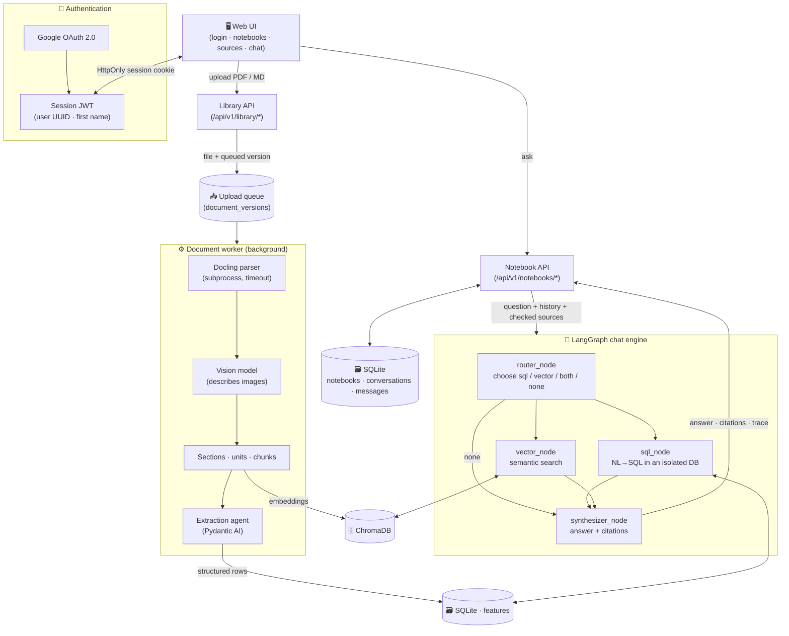

# ArgosAI — Competitive Intelligence System

*Technical Documentation & User Guide*

---

## 1. Overview

ArgosAI is an AI-powered competitive intelligence tool. Users upload competitor documents
(PDF or Markdown) — price lists, brochures, reports — and then ask questions about them in
natural language. Every answer is built only from the documents the user selects, and every
fact carries a numbered citation back to the document, version and page it came from.

The system is designed for **product**, **strategy** and **business intelligence** teams that
want competitive insights quickly, without reading long documents by hand.

It runs as a single-tenant web app: one deployment per organisation, one admin, sign-in with
Google.

---

## 2. Features

- **Library** — documents shared by the whole team. Each document keeps a version history;
  uploading an identical file reuses the existing version, and uploading a file that looks
  like a new version of an existing document suggests linking it as one.
- **Notebooks** — private workspaces. A notebook holds up to 10 sources from the Library,
  each pinned to a version and switched on or off with a checkbox. Each notebook has its own
  conversations.
- **Chat with citations** — answers come only from the checked sources, with `[n]` citation
  chips that show the document, version, upload date and page.
- **Hybrid retrieval** — a router sends each question to structured data (NL→SQL over the
  extracted `features` table), to semantic search (ChromaDB), or to both.
- **Background processing** — uploads are parsed, described (images via a vision model),
  indexed and extracted by a queue worker; the UI shows the progress of each document.
- **Transparent failures** — a failed message can be resent; an answer built while one data
  source was unavailable is marked as incomplete; "Show AI process" reveals the route, SQL,
  document chunks, timings and token usage behind each answer.
- **Voice** — speech-to-text input (language detected automatically) and spoken answers.
- **Admin** — the admin can deactivate users; their documents are transferred to the admin.

---

## 3. System Architecture



### Document processing

Uploading only stores the file and queues a version; a background worker processes it
through these stages, which the UI shows as progress:

`queued → parsing → vision → indexing → extracting → ready` (or `failed` / `cancelled`)

- **Parsing** — Docling reads text, layout and tables in a separate subprocess that is killed
  and restarted if it hangs.
- **Vision** — images and charts are described by an OpenAI vision model; one unreadable image
  does not fail the document.
- **Indexing** — the content is split into chunks and embedded into ChromaDB.
- **Extracting** — an LLM agent writes structured rows (`brand_name`, `product_name`,
  `price`, `price_currency`, `advantages`, `disadvantages`) linked to their source section.
- **Publish** — sections, features and the `ready` status are written in one SQL
  transaction, so chat never sees a half-processed version.

Temporary errors are retried after 1, 5 and 15 minutes (3 attempts). Vision and extraction
results are cached, and a new version of a document reuses the vectors of unchanged chunks,
so reprocessing does not pay twice for the same work.

### Answering a question

1. Only sources that are **checked** and **ready** are used.
2. The **router** picks `sql`, `vector`, `both` or `none`. If routing fails, both are used.
3. **NL→SQL** runs in an in-memory database that only contains the `features` rows of the
   active sources. Other tables do not exist there, the SQL must be a single `SELECT`, an
   authorizer blocks everything else, and there are time and row limits.
4. **Vector search** only returns chunks of the active versions.
5. The **synthesizer** writes the answer in the user's language, citing labels that come from
   the retrieved data. The API returns only the citations actually used.
6. The first answer of a new conversation triggers an auto-generated title.

---

## 4. Security

- **Sign-in** — Google OAuth only. Access is limited to one Google Workspace domain (checked
  through Google's verified `hd` claim, not the email suffix), or to personal Gmail accounts
  when the domain is set to `gmail.com`. The email must be verified by Google.
- **Session** — an `HttpOnly`, `SameSite=Lax` cookie (`Secure` over https) holding a JWT with
  only the user's UUID and first name; it expires after 60 minutes. The token never appears in
  a URL or in JavaScript, and `Authorization: Bearer` headers are not accepted.
- **Every API call requires a signed-in, active user.** The app page and its scripts are only
  served to signed-in users; `/login`, `/css`, `/health/live` and the API docs are public.
- **No direct browser access to the API** — Fetch Metadata headers are checked: opening an
  API URL in the address bar, a link or an iframe, or calling it from another site, returns an
  empty 404. Cookie-authenticated writes without Fetch Metadata must carry an allowed `Origin`.
- **Rate limits per user** (per minute): chat 20, voice 10, upload 10, everything else 120;
  sign-in attempts 10 per IP.
- **Uploads** — streamed with size limits, stored under UUID names (no path traversal), and
  checked for type and page count.
- **Errors** — clients get a stable error code, a safe message and a request ID; technical
  details only go to the log.

---

## 5. Installation

Pick the path that fits your machine:

| Your situation | Recommended path |
|---|---|
| Just want it running, any OS | **A. Docker (CPU)** |
| NVIDIA GPU + Docker | **B. Docker (GPU)** |
| Developing the code (Windows / Linux / Apple Silicon Mac) | **C. Local Python** |
| Intel Mac | **A. Docker** (PyTorch 2.8 has no Intel-Mac build) |

### Step 1 — Get the code and create `.env`

```bash
git clone <repo-url> argos
cd argos
cp .env.example .env        # Windows (cmd/PowerShell): copy .env.example .env
```

`.env` holds **only secrets and the access policy**. Fill in every value — the app refuses to
start if one is empty:

| Variable | What to put there |
|---|---|
| `OPENAI_API_KEY` | Your key from https://platform.openai.com/api-keys |
| `GOOGLE_CLIENT_ID`, `GOOGLE_CLIENT_SECRET` | An OAuth client from Google Cloud Console → APIs & Services → Credentials (see below) |
| `SECRET_KEY` | A long random string: `python -c "import secrets; print(secrets.token_urlsafe(64))"` |
| `ALLOWED_GOOGLE_DOMAIN` | Your Google Workspace domain (e.g. `company.com`), or `gmail.com` to allow personal Gmail accounts |
| `ADMIN_EMAIL` | The email of the single admin account |
| `ALLOWED_ORIGINS` | The URL users open, e.g. `http://localhost:8000` (comma-separated if more than one) |

> ⚠️ Never commit `.env` or paste its values into issues, docs or screenshots. It is listed in
> `.gitignore` and `.dockerignore`.

**Google OAuth client** — create an OAuth client of type *Web application* and add:

- Authorized JavaScript origin: `http://localhost:8000`
- Authorized redirect URI: `http://localhost:8000/api/v1/auth/google/callback`

Use your real domain instead of `localhost:8000` when you deploy.

### A. Docker (CPU) — works everywhere

Requires **Docker Desktop** (Windows/macOS) or Docker Engine (Linux).

```bash
docker compose up -d --build
```

### B. Docker (GPU) — NVIDIA only

Requires an NVIDIA driver, plus Docker Desktop with the WSL2 backend (Windows) or the
[NVIDIA Container Toolkit](https://docs.nvidia.com/datacenter/cloud-native/container-toolkit/) (Linux).
The CUDA build of PyTorch is large: plan for roughly 15 GB of free space on the drive that
holds Docker's data (on Windows this is usually `C:`). If the disk fills mid-build, Docker
Desktop crashes with `failed to receive status: ... EOF`.

```bash
docker compose -f docker-compose.yml -f docker-compose.gpu.yml up -d --build
```

Or let the helper detect the GPU and choose A or B for you:

```bash
python docker_up.py                # detects GPU → CPU or GPU compose
python docker_up.py --device cpu   # force CPU
python docker_up.py -- logs -f     # pass any other compose command
```

### C. Local Python (no Docker)

Requires **Python 3.11 – 3.13**.

```bash
python -m venv .venv
# Windows:      .venv\Scripts\activate
# Linux/macOS:  source .venv/bin/activate

python install.py                  # detects NVIDIA GPU → installs CUDA or CPU PyTorch
python -m uvicorn app.main:app --reload
```

`install.py` options: `--device auto` (default), `--device cuda`, `--device cpu`.
It also creates `.env` from `.env.example` if it does not exist yet, and finishes by
printing whether PyTorch can see your GPU.

> The app must run as **one process** (no `--workers N`): the document worker runs inside
> the app, and ChromaDB's local client is not safe across processes.

### Step 2 — Open the app

| URL | What it is |
|---|---|
| `http://localhost:8000` | The app (redirects to `/login` when you are not signed in) |
| `http://localhost:8000/docs` | API documentation ("Try it out" works when you are signed in in the same browser) |
| `http://localhost:8000/health/live` | Liveness check (public, used by Docker) |
| `http://localhost:8000/health/ready` | Readiness of each component (admin only) |

The account whose email matches `ADMIN_EMAIL` is the admin.

---

## 6. Configuration

| Where | What | Examples |
|---|---|---|
| `.env` | Secrets and access policy only | API keys, OAuth client, `SECRET_KEY`, allowed domain, admin email, CORS origins |
| `app/core/config.py` (`AppConfig`) | Every other setting, as constants in code | Models, timeouts, upload limits, rate limits, notebook size, OCR, worker settings, API docs on/off |
| OS environment (set by `docker-compose.yml`) | Per-machine infrastructure | `DATA_DIR`, `DOCLING_DEVICE`, `HF_HOME` |

**Data** — everything lives in `DATA_DIR` (default `./data`): `argos.db` (SQLite), `chroma/`
(vectors), `queue/` (uploaded files waiting for the worker) and, in Docker, the model cache.
With Docker, `./data` is mounted into the container, so data survives rebuilds.

**Docling device** — `DOCLING_DEVICE` is `auto` (GPU if CUDA/MPS is available, else CPU),
`cuda`, `cpu` or `mps`. The startup log prints the device in use.

**OCR** — off by default (`DOCLING_OCR = False` in `config.py`): text, layout and tables are
extracted directly and images are described by the vision model, so OCR is only needed for
scanned PDFs. Turning it on makes processing slower, especially on CPU.

**Upload limits** (defaults) — PDF or Markdown, 10 MB per file, 100 pages, 5 files and 30 MB
per upload.

**Logs** — JSON lines on stdout with a request ID and context (user, notebook, version,
stage). Every OpenAI call is recorded in the `llm_calls` table (model, tokens, latency,
status — never prompts or document content) and kept for 90 days.

### Docker commands

| Command | Description |
|---|---|
| `docker compose up -d --build` | Build and run in the background |
| `docker compose logs -f` | Follow logs |
| `docker compose down` | Stop and remove containers (data in `./data` is kept) |

### Troubleshooting

| Problem | Fix |
|---|---|
| The app does not start: "Required settings missing in .env" | Fill in every value listed in Step 1 |
| Google says `redirect_uri_mismatch` | Add `http://<host>/api/v1/auth/google/callback` to the OAuth client's redirect URIs |
| Sign-in fails with "This Google account is not allowed to sign in" | The account does not match `ALLOWED_GOOGLE_DOMAIN` (a Workspace domain, or `gmail.com`) |
| `install.py` says CUDA is not available on an NVIDIA machine | Update the NVIDIA driver (CUDA 12.9 needs ≥ 576.x on Windows), or use `--device cpu` |
| First PDF upload is slow | Docling loads/downloads its models on first use; later runs use the cache |
| `ResolutionImpossible` from pip | Use a fresh virtual environment and run `python install.py` (do not `pip install` torch manually) |
| GPU compose fails with "could not select device driver" | NVIDIA Container Toolkit / WSL2 GPU support is not installed — use path A |

---

## 7. API Overview

The API is used by the web app; every endpoint except sign-in and `/health/live` needs a
signed-in user. Full details are in `/docs`.

| Area | Endpoints |
|---|---|
| Auth | `GET /api/v1/auth/google/login`, `GET /api/v1/auth/google/callback`, `POST /api/v1/auth/logout`, `GET /api/v1/users/me` |
| Library | `/api/v1/library/documents` (upload, search, details, rename, delete), `.../versions` (new version, delete version), `/api/v1/library/versions/{id}` (processing status), `/api/v1/library/pending/{id}/resolve` (similar upload) |
| Notebooks | `/api/v1/notebooks` (list, create, rename, delete), `.../sources` (add from Library, upload, check/uncheck, update version, remove) |
| Chat | `POST /api/v1/notebooks/{id}/messages`, `.../conversations` (list, read, rename, delete), `.../messages/{id}/retry` |
| Voice | `POST /api/v1/voice/stt`, `POST /api/v1/voice/tts` |
| Admin | `GET /api/v1/admin/users`, `PATCH /api/v1/admin/users/{id}` |
| Health | `GET /health/live`, `GET /health/ready` (admin) |

Errors always have the same shape:

```json
{"error": {"code": "RATE_LIMITED", "message": "Too many requests. Try again in 60 seconds.", "request_id": "…", "retryable": true}}
```

---

## 8. Development

```bash
pytest tests/ -v
ruff check app tests
```

Every push and pull request to `main` or `develop` runs GitHub Actions: **ruff** and **mypy**
(warnings only for now), **pytest**, and a **Docker** build.

### Dependencies

- `requirements.in` — the **direct** dependencies (edit this one).
- `requirements.txt` — cross-platform lock file generated from it. PyTorch is intentionally
  excluded; `install.py` and the Dockerfile install the CPU or CUDA build.

To add or upgrade a package, edit `requirements.in`, then regenerate the lock
(requires [uv](https://docs.astral.sh/uv/)):

```bash
python lock.py
```

### Database migrations

The schema is versioned in `app/core/migrations.py` and applied automatically on startup.
Add a new migration at the end of the list; never edit one that has already shipped.

---

## 9. Reliability Test

The same question was asked **3 times in a row** to check how consistent the generated SQL and
the answers are, once in **Indonesian** and once in **English**.

> This test was run on an earlier version of Argos, before notebooks and citations, when the
> `features` table used `competitor_name` and `feature_name` (now `brand_name` and
> `product_name`). The answers are kept as they were produced.

### Table A — Indonesian prompt (3 attempts)

*Prompt: "Coba cari tahu tentang Scopely, apa kelebihan atau kekurangan mereka?"*
(*"Find out about Scopely — what are their strengths or weaknesses?"*)

| Attempt | Generated SQL | AI Answer (Summary) |
|---|---|---|
| #1 | `SELECT competitor_name, feature_name, advantages, disadvantages FROM features WHERE competitor_name LIKE '%Scopely%' OR feature_name LIKE '%Scopely%' ORDER BY competitor_name, feature_name;` | Scopely unggul sebagai data source Star Trek™ Fleet Command dan MONOPOLY GO! raih $1.2B di 2023. Tidak ada kekurangan tercantum. |
| #2 | `SELECT competitor_name, feature_name, advantages, disadvantages FROM features WHERE competitor_name LIKE '%Scopely%' OR feature_name LIKE '%Scopely%' ORDER BY competitor_name, feature_name` | MONOPOLY GO! menduduki puncak growth chart revenue 2023 ($1.2B). Scopely juga menjadi basis data case study. Kekurangan: tidak terlihat. |
| #3 | `SELECT competitor_name, feature_name, advantages, disadvantages FROM features WHERE competitor_name LIKE '%Scopely%' OR feature_name LIKE '%Scopely%' ORDER BY competitor_name, feature_name` | Dua kelebihan utama: revenue leadership (MONOPOLY GO! $1.2B) dan data source attribution. Kekurangan tidak tercantum di data. |

### Table B — English prompt (3 attempts)

*Prompt: "Find out about Scopely, what are their strengths and weaknesses?"*

| Attempt | Generated SQL | AI Answer (Summary) |
|---|---|---|
| #1 | `SELECT competitor_name, feature_name, advantages, disadvantages FROM features WHERE competitor_name LIKE '%Scopely%' OR feature_name LIKE '%Scopely%' ORDER BY competitor_name, feature_name;` | Two strengths: data source for Star Trek™ case study + MONOPOLY GO! revenue $1.2B topped 2023 chart. No weaknesses visible. |
| #2 | `SELECT competitor_name, feature_name, advantages, disadvantages FROM features WHERE competitor_name LIKE '%Scopely%' OR feature_name LIKE '%Scopely%' ORDER BY competitor_name, feature_name;` | Scopely shows two clear strengths. MONOPOLY GO! generated $1.2B in 2023 and topped the revenue growth chart. No weaknesses shown. |
| #3 | `SELECT competitor_name, feature_name, advantages, disadvantages FROM features WHERE competitor_name LIKE '%Scopely%' OR feature_name LIKE '%Scopely%' ORDER BY competitor_name, feature_name` | Strengths: data source attribution + MONOPOLY GO! $1.2B revenue leadership 2023. Weaknesses: none visible in current data. |

### Conclusions

- **Consistent SQL:** all 6 attempts produced the same query.
- **Language follows the user:** the answer came back in the language of the question.
- **Consistent content:** the key facts (MONOPOLY GO! $1.2B, Star Trek™ data source) appeared
  in every answer.
- **Natural variation:** sentence structure varied slightly, as expected from a generative model.

---

## 10. Limitations

### Data & ingestion

- Answer quality depends on the uploaded documents. Ambiguous, incomplete or unstructured data
  leads to less accurate extraction.
- Only **PDF** and **Markdown** are supported. DOCX, XLSX and standalone images are not.
- Scanned PDFs need OCR to be turned on in `config.py`, which is slower.

### AI & accuracy

- The LLM can still write a suboptimal SQL query for very complex or ambiguous questions; the
  safety layers only stop it from reading or changing anything it should not.
- Similar-document suggestions are based on text overlap and are only suggestions; the user
  always decides.

### Infrastructure

- **One process only.** The document worker, rate limits and ChromaDB client live in the app
  process, so it cannot be scaled to several workers or instances as is.
- **SQLite** is fine for a team-sized deployment but not for heavy concurrent writes; larger
  setups should move to PostgreSQL.
- **OpenAI costs are per call.** A chat message triggers 3–5 calls (router, NL→SQL, embedding,
  synthesizer, plus a title on the first turn), and each document triggers vision, embedding
  and extraction calls. The router and title use a cheaper model than the synthesizer; the
  models are set in `app/core/config.py`, and every call is recorded in `llm_calls` so costs
  can be monitored.

---

*ArgosAI — Built with FastAPI · LangGraph · Pydantic AI · ChromaDB · SQLite · Docling · Google OAuth · OpenAI*
