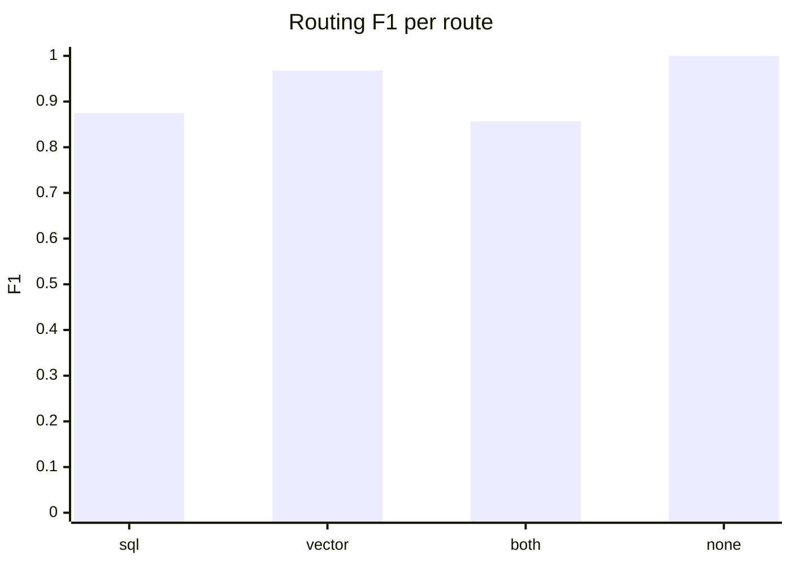

# ArgosAI — Evaluation Results

Benchmark of the full ArgosAI pipeline (document processing, information extraction, query
routing, NL2SQL, performance and consistency) on real competitor documents.

| | |
|---|---|
| Date | 22 November 2026 |
| Models | `gpt-6-luna` (router, NL2SQL, extraction, vision, chat), `text-embedding-3-small` |
| Repeats | every chat and SQL question asked 3 times, each in a new conversation |
| Harness | [`run_eval.py`](run_eval.py) · ground truth [`ground_truth.json`](ground_truth.json) · questions [`questions.json`](questions.json) |
| Raw reports | [`results/20261122_163350`](results/20261122_163350/report.md) (main run), [`results/20261122_140046`](results/20261122_140046/report.md) |

Extraction scores are averaged over both runs, because extraction is an LLM step and varies from
run to run. Every other figure comes from the main run.

---

## Summary

| Area | Metric | Result |
|---|---|---|
| Document processing | documents processed to `ready` | **18 / 18 (100%)** |
| Information extraction (in-domain) | entity-level micro F1 | **0.981** (0.976 – 0.985) |
| Information extraction (held-out) | entity-level micro F1 | **0.846** (0.806 – 0.885) |
| Query routing | accuracy (31 questions) | **93.5%** |
| SQL generation | execution accuracy, 18 questions × 3 runs | **100%** |
| Consistency | same route / same retrieval / same SQL answer over 3 runs | **100% / 96.8% / 100%** |
| Performance | end-to-end latency mean / p50 / p95 | **4.38 s / 4.07 s / 7.78 s** |
| Cost | per chat question · per processed page | **$0.00081** (7,107 tokens) · **$0.0008** |

---

## Datasets

| Set | Documents | Used for |
|---|---|---|
| Notebook A | 10 PDFs: earnings releases, an investor presentation, an infographic, bank financial statements, credit-card terms (RIPLAY), laptop spec sheets | 31 chat questions: routing, latency, consistency |
| Notebook B | 10 PDFs: a car price list, credit-card terms, laptop spec sheets | Extraction against a full hand-labelled reference |
| Held-out | 3 PDFs not used while building the system: a 43-page reseller price list, a 21-page MSRP list, a laptop spec sheet | Extraction against a sampled reference (22 products) |
| SQL reference | a `features` table built from the notebook B ground truth | 18 NL2SQL questions with hand-written gold SQL |

Documents are in English and Indonesian, 1 to 43 pages, 185 pages in total.

---

## 1. Document processing

Every file is uploaded through the Library service and processed by the real queue worker
(Docling → vision → chunking and embedding → extraction).

| Metric | Result |
|---|---|
| Documents reaching `ready` | 18 / 18 |
| Pages | 185 |
| Processing time | 946.7 s (5.1 s per page) |
| AI cost | $0.148 total |

| File | Pages | Chunks | Seconds | Cost (USD) |
|---|---:|---:|---:|---:|
| en_cisco_price_list_reseller.pdf | 43 | 325 | 432.6 | 0.0555 |
| en_lenovo_fy2526_q3_presentation.pdf | 31 | 71 | 31.5 | 0.0095 |
| en_hp_q4_fy2025_earnings.pdf | 21 | 94 | 33.6 | 0.0100 |
| en_datavideo_msrp_2017.pdf | 21 | 87 | 71.0 | 0.0124 |
| id_bank_mega_publikasi_des2025.pdf | 16 | 202 | 63.1 | 0.0156 |
| en_lenovo_t14_gen5_intel.pdf | 11 | 95 | 17.4 | 0.0042 |
| en_lenovo_t14s_2in1_gen1.pdf | 11 | 94 | 16.3 | 0.0041 |
| en_lenovo_t14s_gen5.pdf | 10 | 87 | 18.3 | 0.0040 |
| en_hp_probook4_g1i.pdf | 5 | 37 | 30.6 | 0.0033 |
| id_mega_riplay_gold.pdf | 3 | 19 | 17.2 | 0.0034 |
| id_cimb_riplay_mc_gold.pdf | 2 | 15 | 20.3 | 0.0027 |
| id_cimb_riplay_mc_platinum.pdf | 2 | 14 | 16.2 | 0.0033 |
| id_cimb_riplay_mc_world.pdf | 2 | 13 | 19.3 | 0.0033 |
| id_cimb_riplay_octo.pdf | 2 | 11 | 18.3 | 0.0033 |
| id_icbc_creditcard.pdf | 2 | 14 | 10.2 | 0.0023 |
| id_cimb_niaga_publikasi_des2025.pdf | 1 | 68 | 107.5 | 0.0090 |
| en_lenovo_q2_fy2526_infographic.pdf | 1 | 4 | 13.2 | 0.0012 |
| id_kia_pricelist_jakarta.pdf | 1 | 2 | 10.1 | 0.0009 |

---

## 2. Information extraction

Scored per product (entity level): rows that name the same product are merged, then each field
is compared with the reference. Prices match within ±0.5%. Advantages and disadvantages are free
text and are judged by an LLM.

### In-domain (notebook B, full reference: 25 products)

| Field | F1, run 1 | F1, run 2 | Mean F1 |
|---|---:|---:|---:|
| brand | 1.000 | 1.000 | **1.000** |
| product | 1.000 | 1.000 | **1.000** |
| price | 1.000 | 1.000 | **1.000** |
| currency | 1.000 | 1.000 | **1.000** |
| advantages | 1.000 | 0.842 | **0.921** |
| **micro** | 0.985 | 0.976 | **0.981** |

All 25 reference products are found in both runs, and none of the extracted products is
spurious. The `disadvantages` field has no reference values in these documents. A few extracted
values for it (3 and 2) count as false positives in the micro score.

### Held-out (unseen documents, sampled reference: 22 products)

| Field | F1, run 1 | F1, run 2 | Mean F1 |
|---|---:|---:|---:|
| brand | 0.900 | 0.811 | **0.856** |
| product | 0.900 | 0.811 | **0.856** |
| price | 0.842 | 0.800 | **0.821** |
| currency | 0.895 | 0.800 | **0.848** |
| **micro** | 0.885 | 0.806 | **0.846** |

Precision is 0.99–1.00: what the system extracts is correct. The misses are recall, almost
entirely on the 43-page reseller price list.

| Document | Rows extracted | Sample products found (run 1 / run 2) |
|---|---:|---|
| en_lenovo_t14s_2in1_gen1.pdf | 4 | 1/1 · 1/1 |
| en_datavideo_msrp_2017.pdf | 159 – 203 | 11/11 · 9/11 |
| en_cisco_price_list_reseller.pdf | 1,432 – 1,685 | 6/10 · 5/10 |

---

## 3. Query routing (notebook A)

Each question is labelled with the source that answers it: `sql` (prices and calculations over
prices), `vector` (document text), `both`, or `none` (no document needed).

**Accuracy: 29 / 31 (93.5%).**



| Route | Precision | Recall | F1 |
|---|---:|---:|---:|
| sql | 0.875 | 0.875 | 0.875 |
| vector | 0.938 | 1.000 | 0.968 |
| both | 1.000 | 0.750 | 0.857 |
| none | 1.000 | 1.000 | 1.000 |

Confusion matrix (rows = expected, columns = chosen):

| | sql | vector | both | none |
|---|---:|---:|---:|---:|
| **sql** | 7 | 1 | 0 | 0 |
| **vector** | 0 | 15 | 0 | 0 |
| **both** | 1 | 0 | 3 | 0 |
| **none** | 0 | 0 | 0 | 4 |

---

## 4. SQL generation

Execution accuracy, as in Spider/BIRD. The NL2SQL service generates and runs SQL on the reference
table, and a hand-written gold query runs in the same sandbox. A result is correct when it has
the same rows and every gold answer column appears with the same values (in order, when the
question asks for an order).

| Metric | Result |
|---|---|
| Executable queries | 100% |
| Execution accuracy, first run | 18 / 18 (100%) |
| Execution accuracy, all runs | 54 / 54 (100%) |
| Mean NL2SQL latency | 1.31 s (p95 1.70 s) |

The 18 questions cover minimum and maximum (with ties), averages, counts, threshold and range
filters, sorting, second-cheapest (ranking), spread (max − min), per-brand grouping, NULL
handling and attribute filters.

---

## 5. Performance

Wall-clock time per chat question (router → retrieval → answer), over 93 calls (31 questions ×
3 runs).

```mermaid
xychart-beta
    title "End-to-end latency per route (s)"
    x-axis ["none", "vector", "sql", "both"]
    y-axis "seconds" 0 --> 10
    bar [2.65, 3.85, 5.15, 7.44]
    bar [2.90, 5.38, 8.18, 9.26]
```



*Bars: mean (first) and p95 (second).*

| Scope | n | Mean (ms) | p50 (ms) | p95 (ms) |
|---|---:|---:|---:|---:|
| **end-to-end** | 93 | **4,377** | **4,075** | **7,779** |
| route `none` | 12 | 2,648 | 2,683 | 2,900 |
| route `vector` | 48 | 3,846 | 3,612 | 5,381 |
| route `sql` | 24 | 5,154 | 4,518 | 8,181 |
| route `both` | 9 | 7,440 | 7,253 | 9,259 |
| stage: router | 93 | 1,413 | 1,360 | 1,804 |
| stage: SQL | 33 | 2,041 | 1,513 | 4,659 |
| stage: vector search | 60 | 421 | 360 | 710 |
| stage: answer (synthesizer) | 93 | 1,947 | 1,576 | 3,772 |

Average cost per chat question: **7,107 tokens, $0.00081**.

---

## 6. Consistency

Each question is asked 3 times in a new conversation. A question is consistent when every run
gives the same result.

| Check | Questions | Consistent |
|---|---:|---:|
| Same route | 31 | **100%** |
| Same retrieval (SQL status and row count, pages of retrieved chunks) | 31 | **96.8%** (30 / 31) |
| Same SQL answer (reference table) | 18 | **100%** |
| SQL answer correct in every run | 18 | **100%** |

The exact SQL text matches in only 16.7% of the repeats. The queries are worded differently, but
they return the same answer.

---

## How to run

```bash
python eval/run_eval.py --repeats 3            # full run
python eval/run_eval.py --smoke                # 2 documents per notebook, 4 questions per set
python eval/run_eval.py --rescore <RUN>        # rescore an existing run with the current ground truth
```

Options: `--no-judge` skips the LLM judge for free-text fields, and `--no-validation` skips the
held-out set. Each run writes `report.md` and `report.json` to `eval/results/<timestamp>/`.
